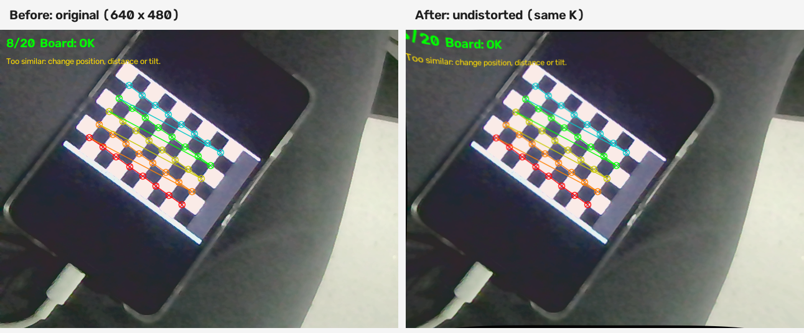
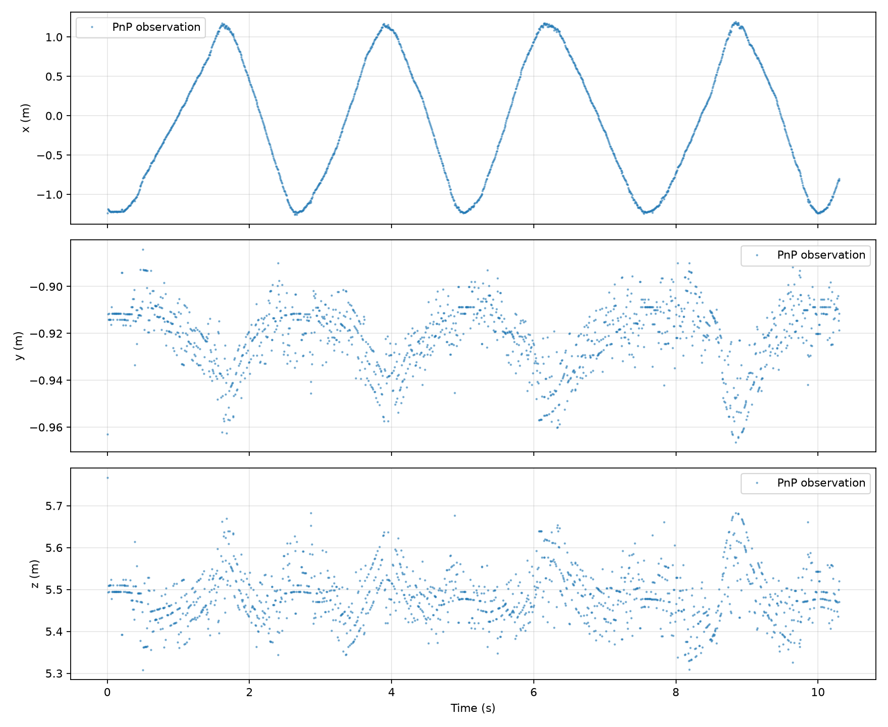
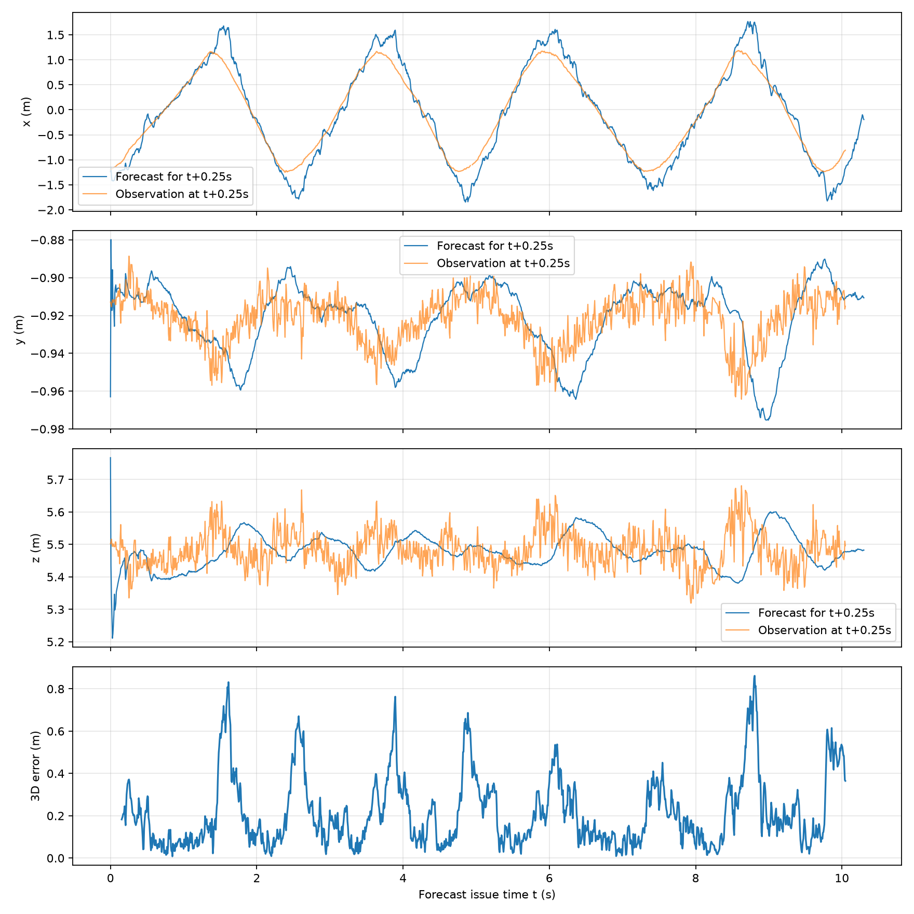
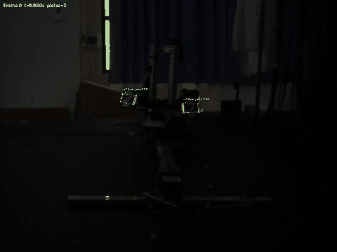

# MountainForge 视觉组 2027 赛季招新考核：丁美言

本仓库提交公共题与 A 方向题的代码、原始实验资料、参数、CSV、图表、识别视频及设计说明。A 题以传统视觉方案作为主结果，另提交使用自备 YOLO ONNX 模型的独立扩展。两套观测与结果分目录保存。

> 原考核文件列明的考核时间为 2026-10-16 至 2026-10-19。本次仓库整理提交发生于 2026-10-21，包含此后整理的说明和模型接入材料；按实际 Git 提交日期记录，不回填提交时间。原有两次网页上传提交完整保留。

## 1. 完成情况与材料入口

| 考核内容 | 当前状态与实际证据 | 入口 |
|---|---|---|
| 题一：Python 与依赖 | Python 3.12.14，numpy、OpenCV、matplotlib、PyYAML 可用；提供环境检查程序与当前运行记录 | [q1_env](q1_env/README.md) |
| 题一：GitHub 工程规范 | 按题目目录整理，保留原提交；当前仓库名带额外连字符，与推荐名称并非完全相同 | 本仓库、[复现说明](docs/reproducibility.md) |
| 题一发挥：Ubuntu | 既有截图显示 Ubuntu 22.04.5 LTS、ls -la、top 和 CPU 信息命令 | [环境截图](q1_env/README.md#ubuntu-证据) |
| 题二：相机标定 | 20 张 640×480 图像；8×5 内角点；方格边长输入 33 mm；重投影 RMSE 约 0.2073 px | [q2_calib](q2_calib/README.md) |
| 题二：去畸变 | 原图、去畸变图及对比图已提供 | [对比图](q2_calib/figures/09_comparison.png) |
| 题二：A4 实测 | 仅保存 3 组，距离 0.3043～0.5786 m，误差较大；不足至少 5 组且未覆盖 0.5～3 m | [实测记录与局限](q2_calib/README.md#a4-实测结果) |
| 题二发挥 | 有现有三组误差图和原因讨论；无完整三角度、五图标定等实测对照，不申报为已完成 | [题二说明](q2_calib/README.md) |
| A 基本：红色装甲板识别 | 两段逐帧检测、四点、视频均已提交；存在漏检和部分 PnP 失败 | [qA_aim](qA_aim/README.md) |
| A 基本：PnP 与轨迹 | 相机坐标位置、yaw、位置时间曲线和 x–z 轨迹已提交 | [主结果图表](qA_aim/README.md#结果图表) |
| A 基本：0.25 s 预测 | 6 状态卡尔曼滤波、未来对齐、1482 个有效比较；RMSE 约 0.2711 m | [预测结果](qA_aim/figures/prediction_comparison_tuned.png) |
| A 基本：阈值工具 | 红蓝颜色、亮度滑动条工具；提供实际窗口截图 | [工具与截图](qA_aim/README.md#阈值工具) |
| A 发挥：近距离与蓝色 | 近距离四点/PnP、蓝色检测视频和 CSV 已提交；蓝色位姿列为空 | [复杂场景](qA_aim/README.md) |
| A 发挥：小陀螺中心与转速 | 两段中心、角速度 CSV 和曲线；有模型假设与独立真值缺失的局限 | [模型说明](qA_aim/陀螺中心与转速估计说明.md) |
| A 发挥：Q/R 对比 | 同一观测集 25 组实验，固定比较时刻，提供曲线、统计和原始轨迹 | [Q/R 报告](qA_aim/qr_analysis/Q_R参数影响分析.md) |
| 扩展：YOLO 模型接入 | ONNX 四点模型，4 段视频完整处理；CPU 推理；不申报为自行训练网络 | [qA_yolo](qA_yolo/README.md) |
| B 题 | 未完成，按考核要求不建该方向目录 | — |
| 附加题一 | 未提供训练与 PyTorch/ONNX Runtime CPU 对比，不申报完成 | [模型来源](docs/data_and_model_sources.md) |

## 2. 仓库结构

```text
README.md                    总设计报告与导航
ai_log.md                    5 项关键 AI 辅助记录，不包含完整聊天
requirements.txt             通用依赖
requirements-tested.txt      本机已验证版本
q1_env/                      环境检查与 Ubuntu 原始截图
q2_calib/                    标定代码、20张图、参数、A4实测与去畸变
qA_aim/                      传统方案主结果、实验对比、CSV与全部图表视频
qA_yolo/                     模型方案、模型权重、注释代码及独立结果
data/armor/                  考核提供的4段输入视频和工业相机参数
docs/                        问题回答、材料索引、复现记录、来源与既有上传归档
tools/                       文件格式与媒体完整性检查
```

## 3. 复现入口

需要 Python 3.10 及以上版本。以下命令在仓库根目录执行：

```bash
python -m venv .venv
# Windows PowerShell: .\.venv\Scripts\Activate.ps1
# Linux/macOS: source .venv/bin/activate
python -m pip install -r requirements.txt
python q1_env/check_environment.py
python tools/validate_submission.py
```

如使用本机同版本依赖，可改为安装 `requirements-tested.txt`；该文件记录实际运行版本，不保证未来所有平台均有对应 wheel。相机实时采集代码按 Windows USB 摄像头接口编写，Linux 使用时需要选择相应后端。

传统方案完整流程：

```bash
python qA_aim/run_analysis.py --video all
python qA_aim/run_extra.py --video all
python qA_aim/estimate_spin.py --video all
python qA_aim/analyze_qr.py
python qA_aim/compare_distortion.py
```

模型方案：

```bash
python qA_yolo/preview_yolo.py --video 中距离陀螺
python qA_yolo/run_analysis.py --video all
python qA_yolo/run_extra.py --video all
python qA_yolo/estimate_spin.py --video all
```

GUI 需要有桌面显示的环境。`yolo_detector.py` 是被其他文件导入的模块，直接运行它不会弹出窗口。详细命令、输入输出与字段解释见各题 README。

## 4. 题二方案与结果摘要

使用平面棋盘格的三维角点与图像角点完成相机标定，再使用已知尺寸 A4 纸四角进行 PnP 测距。USB 相机 K 为：

```text
[[679.84939735,   0,          313.56512996],
 [  0,         679.91700180, 239.37191511],
 [  0,           0,            1         ]]
D = [0.15283405, 0.18595483, 0.00324167, -0.00191225, -3.70450216]
```

20 张图像的拟合 RMSE 为 0.207279 px，但三个 A4 实测相对误差仍达 13.29%、23.23%、27.41%。因此标定拟合误差小不能直接推出外部测距准确。A4 角点选择、姿态、纸张平整度、尺测基准及标定图姿态覆盖都需要复核；当前不宣称题二测距验收通过。



## 5. A 题方案与结果摘要

传统方案采用颜色差、亮度分割、轮廓几何筛选、灯条配对和四点 PnP。物体模型按灯条长 55 mm、中心距 135 mm 建立。坐标系 x 向右、y 向下、z 向前，位置单位 m，yaw 单位 rad。工业相机参数与题二 USB 参数独立使用。

远距离平移采用状态 `[x,y,z,vx,vy,vz]` 的匀速卡尔曼模型。预测使用当前及历史观测，未来观测仅用于评价。150 fps 下 0.25 s 等于 37.5 帧，因此使用 f+37 和 f+38 两帧观测均值对齐；排除初始化及缺失数据后有 1482 组有效比较。平均三维差约 0.2136 m，RMSE 约 0.2711 m，95% 分位约 0.5883 m。换向附近仍存在超调。




小陀螺采用四板等角间隔、共享有效半径、近似水平旋转模型。对周期相位进行滤波，用过去 0.6 s 窗口稳健拟合中心与半径。中距离角速度中位数约 -20.62 rad/s（3.28 圈/s），近距离约 -22.76 rad/s（3.62 圈/s）。没有编码器真值；中心稳定与曲线平滑不是绝对位置精度证明。


完整视频入口：[远距离](qA_aim/figures/detected_远距离平移.mp4)、[中距离](qA_aim/figures/detected_中距离陀螺.mp4)、[近距离](qA_aim/figures/detected_近距离陀螺.mp4)、[蓝色](qA_aim/figures/detected_装甲板_蓝.mp4)。网页如不支持当前视频编码，可下载播放；同时提供 GIF 预览和静态截图。

### 中距离识别网页预览（前6秒）



## 6. 扩展方案与工程比较

YOLO 方案使用自备 ONNX 四关键点模型，通过 OpenCV DNN 在 CPU 上运行。输入预处理、类别过滤、NMS 和坐标还原均在代码中明确实现，PnP 与预测仍沿用基础几何流程。

中、近距离能检测出装甲板，但远距离小目标有明显漏检和关键点偏差。没有以更低重投影残差宣称实际精度提升，也没有将不同有效样本上的预测 RMSE 直接作为公平优劣结论。保留传统版作为主提交便于对照。

## 7. 问题记录与解决过程

| 问题 | 定位依据 | 处理及尚存局限 |
|---|---|---|
| 相对路径导致视频无法打开 | 终端工作目录与脚本目录不同 | 提交版输入从仓库 data/armor 定位，不依赖个人桌面路径 |
| 平面 PnP 多解和侧视深度异常 | 候选位姿、重投影与原图检查 | 正深度、3px残差检查；仍存在深度尾部和yaw不稳定 |
| 匀速预测在换向处超调 | 未来对齐曲线、误差峰值 | 过程噪声时间积分、按方向软降权及Q/R对照；仍受运动模型限制 |
| 换板被误当作目标运动 | 多板散点与yaw周期 | 利用四板周期相位估计；依赖几何假设且没有持续板ID |
| 端点优化收益不明确 | 相同3335候选前后对照 | 残差下降约20%，失败数与深度尾部未解决，实验版单独保存 |
| A4误差较大且样本不足 | 尺测与PnP比较 | 保留三组原始记录，明确不足，不用模拟数据补齐 |
| 模型接入后远距离性能下降 | 完整视频与独立CSV | 不替换传统主结果，保留模型扩展与结果限制 |

## 8. 学习总结与后续验证

本次学习围绕完整数据流展开：图像并不是三维位置；检测提供像素关键点，PnP通过相机模型和真实尺寸给出位置，滤波结合历史观测估计运动，预测还受到模型与延迟的限制。

实验中最需要区分的是三类量：模型对当前数据的拟合残差、预测与未来观测的差、相对于独立尺测或编码器真值的误差。三者不能互相替代。参数更平滑、框更稳定、有效输出更多，也不能单独证明真实精度提高。

当前代码有 AI 辅助生成、修改和解释，不能据此认定考生已独立掌握全部实现。后续重点是独立讲解关键点顺序、坐标与单位、Q/R、PnP多解、相位周期，完成未公开数据测试，并补齐真实A4测量和标定板尺寸证据。当前仓库是离线视觉与估计实验，不含实车执行或发射控制。

## 9. 问题回答、来源与核验

- [A题七项问题回答](docs/armor_questions.md)
- [题二概念与实测分析](q2_calib/README.md)
- [AI使用记录：5项技术交互](ai_log.md)
- [数据、模型来源与许可说明](docs/data_and_model_sources.md)
- [复现、验证与版本说明](docs/reproducibility.md)
- [完整材料索引](docs/material_index.md)
- [原始考核要求](docs/assessment_requirements.md)
