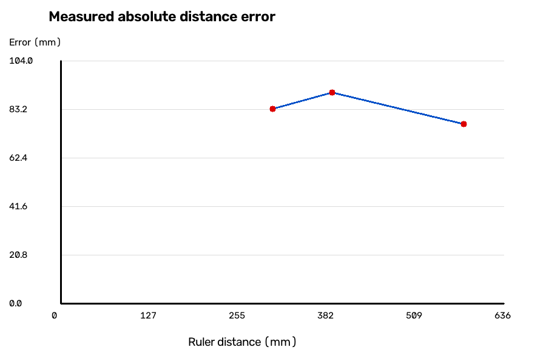

# 题二：相机标定与单目测距

## 实验状态

已保存20张USB相机标定图、参数文件、逐图重投影误差、去畸变对照、A4角点测量代码与三组实测记录。A4数量不足5组，距离范围不完整，且误差明显，不能表述为题二全部达标。

## 标定输入与参数

- 分辨率640×480，20张图。
- 内部角点规格8列×5行；现场记录使用的方格边长输入为33mm。该数值来自保存的配置，仓库没有独立的方格尺测照片，不能补充为新的实测证据。
- 原始结果目录：calibration_runs/20261016_192448_766416。
- 另一个20261016_192305_100394目录只保存早期单张采集，不作为完整标定结果。

```text
K = [[679.84939735, 0, 313.56512996],
     [0, 679.91700180, 239.37191511],
     [0, 0, 1]]
D = [0.15283405, 0.18595483, 0.00324167, -0.00191225, -3.70450216]
OpenCV RMS = 0.2072794094 px
重新按角点距离计算的RMSE = 0.2072792441 px
```

[完整参数JSON](calibration_runs/20261016_192448_766416/calibration.json)；[逐图残差CSV](calibration_runs/20261016_192448_766416/per_image_errors.csv)；[20张原始图](calibration_runs/20261016_192448_766416/images)。

### 标定步骤

先检测棋盘格内部角点，再进行亚像素细化。使用平面网格物体点和每张图片的二维角点调用calibrateCamera，联合估计内参、畸变和每张图的外参。通过projectPoints重投影，统计每张图和全体角点的二维欧氏RMSE。

采集程序默认规格是8×6；本次实际数据是8×5，因此复现时必须明确传入--rows 5，不应直接沿用默认参数。

```bash
python q2_calib/calibrate_usb.py --camera 0 --cols 8 --rows 5 --square-mm 33 --count 20
python q2_calib/reproduce_calibration.py
python q2_calib/undistort_image.py --image q2_calib/calibration_runs/20261016_192448_766416/images/09.png
```

第一条连接真实相机并重新采集；第二条只读取仓库现有20张图进行离线复现；第三条生成09号图的去畸变对比，不需要相机。


## A4 实测结果

A4物体点以纸张中心为原点，尺寸210mm×297mm。使用交互点击得到纸张四角，按对应顺序调用PnP。tvec单位为mm；中心直线距离为sqrt(tx²+ty²+tz²)，depth_z是相机向前的深度，两者不能混用。

当前采用a4_three_groups_corrected/comparison.csv。第1组尺读数已按现有记录纠正为578.6mm；保留a4_results中的旧记录用于追溯，不将旧、新数据拼为6次独立实验。

| 组别 | 尺测/mm | PnP中心距离/mm | 绝对误差/mm | 相对误差 |
|---|---:|---:|---:|---:|
| 1 | 578.60 | 501.68 | 76.92 | 13.29% |
| 2 | 389.30 | 298.87 | 90.43 | 23.23% |
| 3 | 304.30 | 387.71 | 83.41 | 27.41% |



保存表中的重投影RMSE约36.9～74.5px，远大于标定角点拟合误差；估计倾角约45～49°，即使nominal_angle列填写0，也不能据此把这些数据当成经过验证的正对测量。需要首先复核四角顺序与点击位置、图像是否原始未缩放、纸张尺寸与姿态、尺测起止基准及对焦设置。

### 误差分析

1. 四角点击与对应关系：像素点偏离纸角、顺序错位，会直接影响位姿与距离。
2. 标定姿态覆盖不足：20张并不自动保证参数稳定；角度、位置和距离需要充分变化，不能只看图像数量。
3. 目标与标定板物理尺寸：纸张弯曲、实际方格尺寸与输入不一致，会产生几何模型误差。
4. 光学与成像状态：焦距、自动对焦、图像缩放或裁剪改变内参适用条件。
5. 尺测基准：从镜头、机壳还是目标边缘量距离会影响与tvec中心距离的比较。

这些是需要核对的原因，不是已经逐一证明的误差来源。现有3个距离点不足以证明一般性的误差随距离规律。

## 必答问题

### 内参矩阵参数的物理含义；fx与fy为何接近？

fx、fy是分别沿图像横、纵轴表达的像素焦距；cx、cy是主点坐标。fx=f/pixel_pitch_x，fy=f/pixel_pitch_y。若像素近似正方形且图片没有不等比缩放，两者通常接近，并非算法要求强制相等。本次fx约679.849、fy约679.917px。

### 重投影误差衡量什么？

使用估计的相机参数和位姿把三维角点投回图像，与实际检测角点比较。这里采用sqrt(mean(dx²+dy²))，单位像素，衡量当前数据的几何拟合程度；不等于毫米级测距误差，也不能证明新图像上的精度。

## 发挥部分：现有证据与理论判断

未保存完整的同距离0/30/60度对照、5图标定对照、全正对数据集对照和错误边长对照，因此不补写数值实验。理论上：图像太少或姿态近似重复会降低约束；所有图像近正对时部分参数更难分离；统一改变方格尺寸主要改变外参平移的尺度，在理想同一角点条件下内参不应按相同比例变化。若后续PnP使用真实A4尺寸，不能直接断言A4距离会随标定方格输入按比例缩放。

## 文件说明

- calibrate_usb.py：相机采集、角点检测与标定。
- reproduce_calibration.py：从保存图像离线复现，并生成角点检查图。
- take_photos.py：保存原始相机照片。
- undistort_image.py：去畸变及对比图。
- measure_a4.py：真实相机拍摄、四角选择、尺读数输入、PnP及误差图。
- historical_scripts/：早期程序与棋盘格图，仅用于过程追溯，其默认规格不代表最终实验规格。
