# A题：装甲板识别、位姿解算与运动预测

此目录是传统视觉主方案。YOLO扩展独立保存在../qA_yolo，避免检测结果、滤波缓存和图表互相覆盖。当前平移参数Q的强度为[3,0.001,0.001]，测量标准差为[0.01,0.015,0.06]m。

## 1. 识别设计

1. BGR图像中，以R-B>45、R-G>25、R>110分割红色亮区域；差分先转int16避免uint8溢出。
2. 3×3闭运算连接细小断裂；提取外部轮廓。
3. 面积至少6px²、长度至少6px、宽度至少1px、长宽比1.8～25、长轴竖直分量大于0.75，筛选灯条。
4. 灯条按x排序后两两检查：归一化间距0.8～4、上下错位小于0.6、长度比例大于0.55、平行程度大于0.94。
5. 按间距接近135/55、上下错位小、长度一致性高的分数贪心配对，禁止重复使用同根灯条。
6. 长轴端点组成LT、LB、RB、RT四点；输出候选并绘制四边形。

几何阈值来自此组录像调试，是经验范围，不保证跨相机通用。红色主流程尚未加入“禁止跨越中间灯条”的规则，仍可能跨板误配；蓝色分支加入了同高度中间灯条检查。没有数字分类器，也没有持续的装甲板ID。

蓝色方案在blue_detector.py，使用B-R>30、B>180、G>100提取灯条亮核，并用列支持度约束减轻光晕。遮挡后没有用预测伪造不可见装甲板。

## 2. PnP几何约定

```text
LT=(-0.0675,-0.0275,0)
LB=(-0.0675, 0.0275,0)
RB=( 0.0675, 0.0275,0)
RT=( 0.0675,-0.0275,0)
```

单位m，图像点与以上四点逐一对应。使用data/armor/camera_info.json中的K与畸变，solvePnPGeneric的IPPE分支得到平面候选，排除物体点深度非正及重投影RMSE>3px的解，再选残差最小者。

位置为物体原点到相机坐标系的平移，x右、y下、z前。z是深度，直线距离应取tvec范数。yaw=atan2(R[0,2],R[2,2])，表示模型+Z法线在相机x–z平面的角度，不是欧拉角全姿态，也不是角速度。当前未做跨帧PnP多解连续性优化。

## 3. 检测输出统计

| 视频 | 总帧 | 有候选帧 | 候选行 | 有效PnP行 |
|---|---:|---:|---:|---:|
| 远距离平移 | 1546 | 1544 | 1544 | 1544 |
| 中距离陀螺 | 2550 | 2550 | 3335 | 3249 |
| 近距离陀螺 | 2105 | 2105 | 2718 | 2577 |
| 装甲板_蓝 | 1684 | 1507 | 2533 | 不解算 |

统计是候选覆盖与有效输出数，不是准确率或召回率。中距离86个、近距离141个候选没有通过PnP，位姿留空；不把失败值写成0。未检出帧不写候选行，同帧可有多块板。

```text
frame,lt_x,lt_y,lb_x,lb_y,rb_x,rb_y,rt_x,rt_y,x,y,z,yaw
```

## 4. 平移关联与滤波

首次或长时重获选面积最大的候选，否则选距上次3D位置最近者；正常连续观测中拒绝超过0.6m的跳变。这是简单关联，不是可靠多目标跟踪。

状态s=[p,v]，F=[[I,dtI],[0,I]]，H=[I,0]，dt=1/150s。令Dq=diag(qx,qy,qz)，连续白噪声加速度的离散Q为：

```text
Q = [[Dq*dt³/3, Dq*dt²/2],
     [Dq*dt²/2, Dq*dt   ]]
R = diag(0.01²,0.015²,0.06²) m²
```

预测、观测更新均由NumPy实现。观测与预测的新息相差过大时，按方向增加有效测量方差，最大100倍；使用Joseph形式更新协方差。主方案是软降权，不是把所有大新息观测整帧删除。

缺少观测时短时外推，连续缺少超过30帧停止输出，长时重获重新初始化。用当前更新状态计算p(t+0.25)=p(t)+0.25v(t)，预测输入中不使用未来观测。

### 评价口径

0.25s=37.5帧，对照位置由f+37和f+38的观测均值获得，两帧都需有效。前0.15s初始化段、缺少未来观测及尾部不计入误差。1482组有效比较：平均三维差0.213640m、RMSE0.271113m、95%分位0.588307m；各轴RMSE为0.258131、0.016265、0.081277m。

这些是对未来PnP观测的比较，未来观测也带噪声，并非独立绝对位置真值。换向时目标有加减速，匀速模型仍会超调，不能只凭调小Q保证解决。

## 结果图表


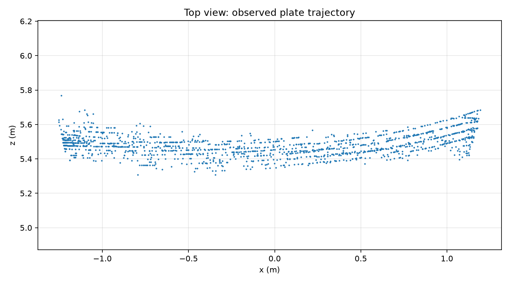
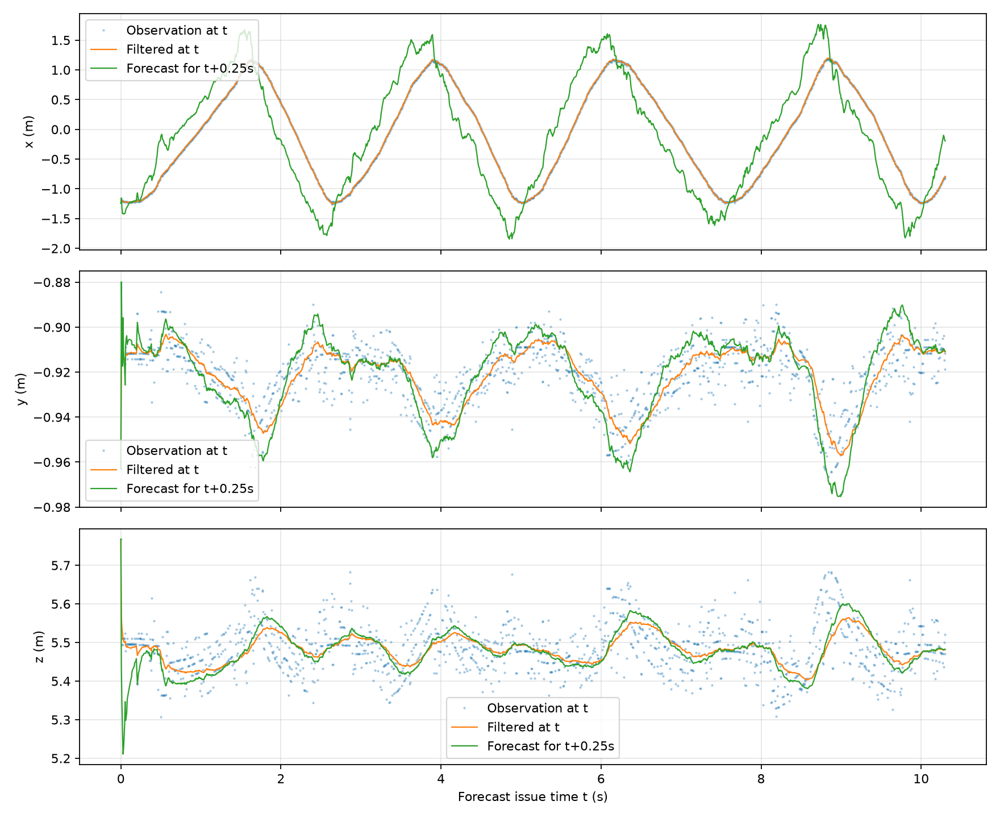


### 视频与静态检查图

| 视频 | 完整结果 | 静态图 |
|---|---|---|
| 远距离平移 | [MP4](figures/detected_远距离平移.mp4) | [位置图](figures/position_time.png) |
| 中距离陀螺 | [MP4](figures/detected_中距离陀螺.mp4) | [关键点检查](figures/spin_inspection.jpg) |
| 近距离陀螺 | [MP4](figures/detected_近距离陀螺.mp4) | [多帧检查](figures/contact_近距离陀螺.jpg) |
| 蓝色装甲板 | [MP4](figures/detected_装甲板_蓝.mp4) | [多帧检查](figures/contact_装甲板_蓝.jpg) |

## 阈值工具

```bash
python qA_aim/tune_thresholds.py
python qA_aim/tune_spin.py
```

空格播放/暂停，S保存参数与面板，Q退出。远距离thresholds.json、中距离thresholds_spin.json分开保存。以下是实际窗口截图，参数均为45、25、110，展示不同视频时刻，不是不同参数的对照实验。

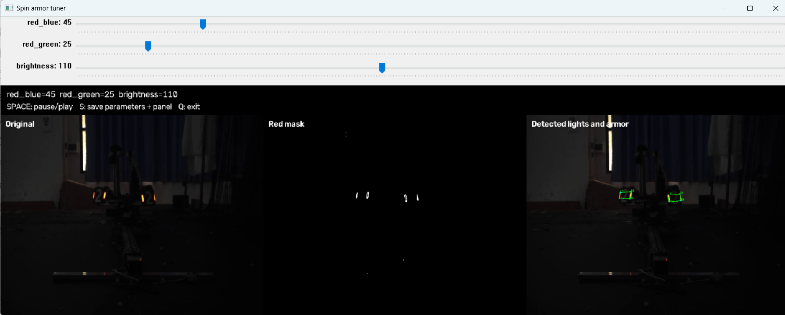
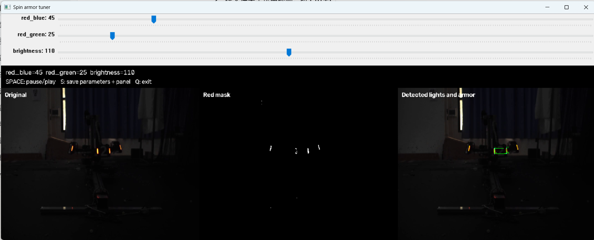

## 5. 小陀螺中心与角速度

采用四板等角间隔、共享半径、水平转动的简化模型：p_i=c-r[sin(theta+k*pi/2),0,cos(theta+k*pi/2)]。对exp(4j*yaw)聚合相位，减轻换板的90°跳变；前0.6s初始化，再用[theta,omega]卡尔曼滤波。

以截至当前的0.6s观测窗口稳健拟合中心和半径，按重投影残差、相位不一致与位置残差降低异常样本权重。不把一个全局固定中心复制给所有时刻，不倒填初始化结果。缺少可用相位超过0.2s停止输出。

| 视频 | 中心坐标中位数/m | 角速度中位数/rad·s⁻¹ | 转速大小/圈·s⁻¹ |
|---|---|---:|---:|
| 中距离 | (-0.0644,-0.2407,3.6442) | -20.6246 | 3.2825 |
| 近距离 | (-0.0090,-0.1062,2.5712) | -22.7630 | 3.6228 |

中心cy定义为平均装甲板中心平面高度，不是质量中心。估计依赖几何假设，速度曲线仍有明显波动；无编码器或独立中心真值。模型拟合残差、中心时间标准差和真实位置误差必须区分。


详见[中心与转速报告](陀螺中心与转速估计说明.md)。

## 6. Q、R实验与畸变对照

固定同一观测、初始化和未来评价时刻，Q与R方差倍率均取0.01、0.1、1、10、100，得到25组实验。基准1482样本；R倍率作用于方差，配置中标准差应乘倍率平方根。

Q过小、R过大可能使变化跟随不足；Q过大、R过小可能放大观测抖动。当前门限触发数量也随配置变化，因此不是理想无异常处理滤波器的纯理论试验。结果和全轨迹在[qr_analysis](qr_analysis/Q_R参数影响分析.md)。

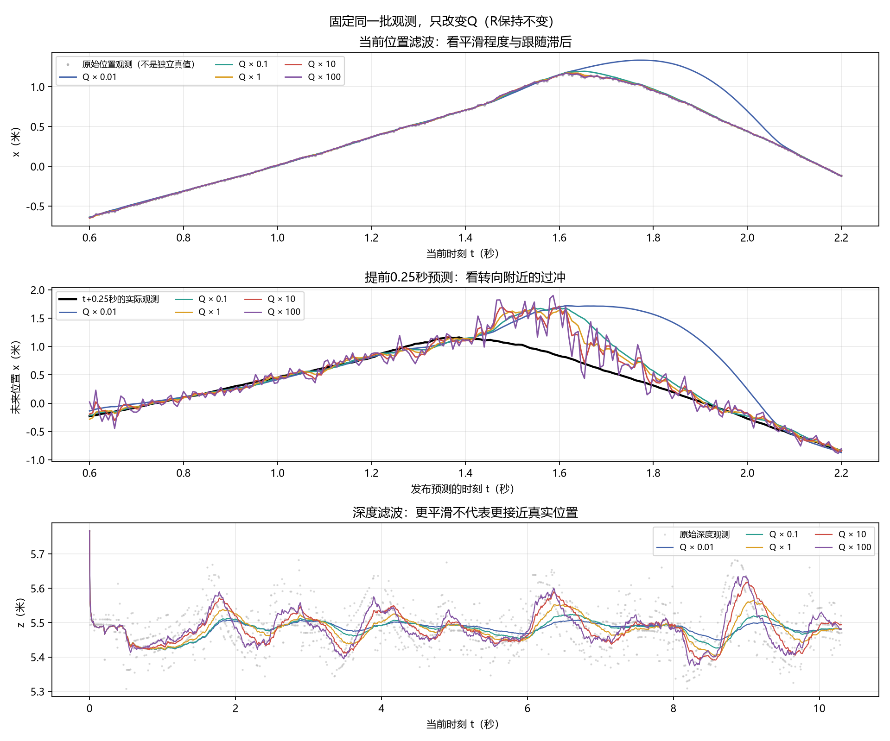
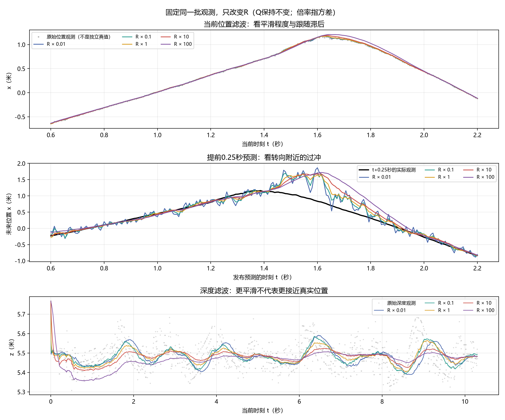
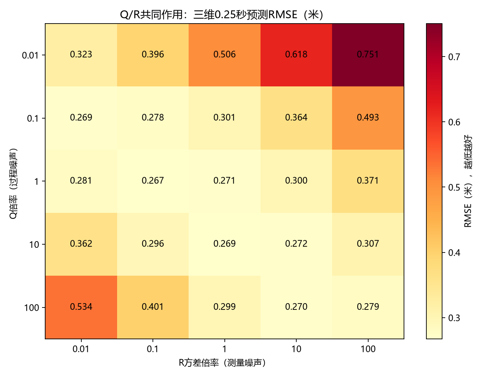

同关键点有/无畸变对照位置差中位数：远距离6.86mm、中距离1.95mm、近距离0.81mm。这是两次解算的差，不是独立真值误差。按主点距离分组的相对外侧不等于图像边缘；远距离未呈单调增大，不能将不同深度姿态的分组差异归因于位置一项。

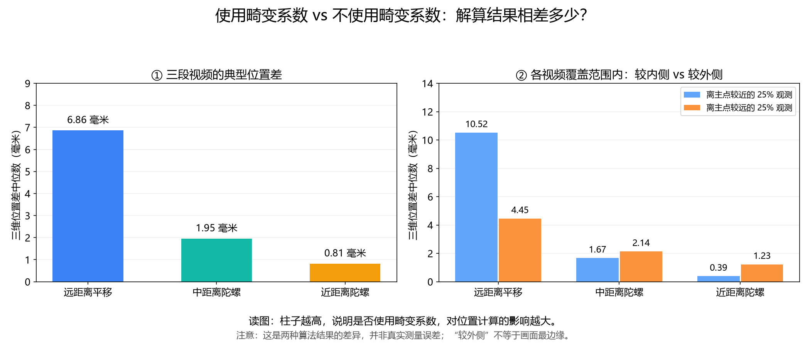

## 7. 优化与历史结果

spin_refined保存行中心线端点与PnP LM实验：同3335候选，共同有效3239行的残差中位数由0.7124降至0.5671px，约下降20%；总失败数仍86，深度尾部未消除。没有独立真值，不认定其距离更准，主CSV未替换。

调整前备份、filter_tuning_comparison.json与filter_before_after.png记录历史滤波调整，其中调整后曾使用Qx=30，与当前Qx=3不同；不得混写为当前性能。filter_prediction.png、prediction_comparison.png等无tuned后缀图是历史版本，主结果请使用带tuned文件。

## 8. 运行与输出

在仓库根目录依次运行：

```bash
python qA_aim/run_analysis.py --video all
python qA_aim/run_extra.py --video all
python qA_aim/estimate_spin.py --video all
python qA_aim/analyze_qr.py
python qA_aim/compare_distortion.py
```

已有观测缓存时只重算预测：python qA_aim/run_analysis.py --predict-only。端点实验：python qA_aim/compare_spin.py。

pred_远距离平移.csv列t,x,y,z，t为当前观测时刻、位置是未来0.25s预测。两份陀螺pred列t,cx,cy,cz,omega，前90帧初始化为空。CSV默认UTF-8 BOM，空位姿表示失败或缺少观测，不用0替代。

完整必答问题见[七项回答](../docs/armor_questions.md)；格式检查见tools/validate_submission.py。所有输入从仓库data/armor读取，不需要个人桌面目录。

## 网页快速预览

以下GIF仅展示前6秒、降采样至约10fps，便于网页浏览；完整帧率与完整时长以MP4和CSV为准。

### 远距离平移

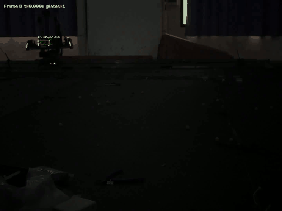

### 中距离陀螺


### 近距离陀螺

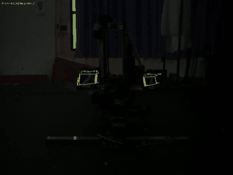

### 装甲板_蓝

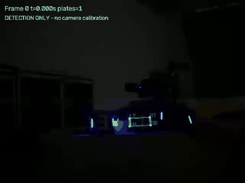

