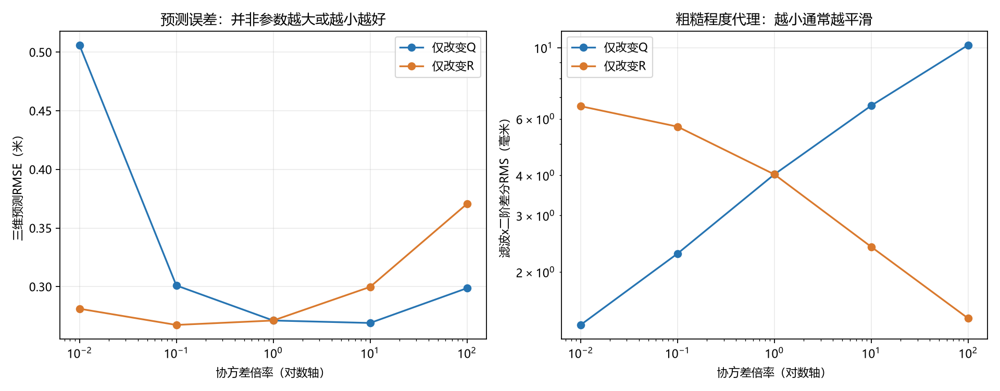

# 卡尔曼滤波参数Q、R对滤波与预测效果的影响

## 1. 实验目的与方法

研究过程噪声协方差Q和测量噪声协方差R，如何影响估计的平滑程度、对运动变化的跟随，以及未来0.25秒的位置预测。

固定同一段“远距离平移”视频的原始PnP观测，不重做检测、不改相机参数、不改时间戳。状态为[x,y,z,vx,vy,vz]，匀速模型，dt=1/150秒。所有实验采用相同初值、初始协方差和异常处理逻辑。

基准设置：

```text
q₀ = [3, 0.001, 0.001] m²/s³
测量标准差σ₀ = [0.01, 0.015, 0.06] m
R₀ = diag(0.0001, 0.000225, 0.0036) m²
```

Q由q₀按照连续白噪声加速度模型对dt积分得到。记D=diag(q)，则Q的四个3×3块分别为Ddt³/3、Ddt²/2、Ddt²/2、Ddt。

实验倍率α、β分别取0.01、0.1、1、10、100：Q=αQ₀，R=βR₀，共25组。其中固定β=1观察Q，固定α=1观察R。这里改变的是整个Q或R矩阵，不是仅改变x方向，不能与此前只试Qx的实验混淆。

**R倍率指方差倍率。** 程序配置填写的是标准差，因此实现R×β时，将σ改为σ₀×sqrt(β)。例如R×100对应标准差×10，不是×100。

当前程序有基于新息的方向软门限，阈值4、最大测量方差膨胀100倍；各实验保持此逻辑不变。Q/R改变后门限触发次数仍会变化，所以本实验描述的是当前带异常处理的滤波器，不是完全没有门限的理想线性卡尔曼滤波。

## 2. Q、R的作用

预测协方差满足P⁻=FPFᵀ+Q，卡尔曼增益为K=P⁻Hᵀ(HP⁻Hᵀ+R)⁻¹，观测更新为x⁺=x⁻+K(z-Hx⁻)。Q代表过程模型噪声，R代表测量噪声；这些定义与[OpenCV KalmanFilter官方文档](https://docs.opencv.org/4.13.0/dd/d6a/classcv_1_1KalmanFilter.html)一致。本项目使用NumPy实现相同的预测/修正关系，并保留软门限。

在其他条件固定时，增大Q通常使模型预测的不确定性增大，让观测更快修正状态；增大R通常减弱观测的更新权重。对于本实验这种多维、带门限的系统，不能将增益或性能变化理解为所有指标均严格单调。

| 调整 | 常见滤波表现 | 对预测的风险 |
|---|---|---|
| Q过小 | 更信任匀速模型，曲线更平滑，但运动变化跟随较慢 | 转向时速度修正不及时，继续向旧方向外推 |
| Q较大 | 更快响应观测，保留更多短时变化 | 测量抖动进入速度估计，外推后更明显 |
| R过小 | 对观测信任较强 | 把像素/测距噪声也当作运动；还可能频繁触发软门限 |
| R较大 | 减弱观测影响，结果通常更平滑 | 转向或加减速时更新不足；长期更依赖模型 |

因此，平滑与响应速度之间存在折中，滤波图更平不等于未来预测更准。

## 3. 评价口径

- 预测时长固定0.25秒，不用缩短时长来降低误差。
- 150fps下0.25秒为37.5帧，以第f+37与f+38帧有效观测均值作为未来比较值。两帧必须都有效。
- 排除前0.15秒初始化段和没有未来观测的尾段；每组均使用完全相同的1482个时刻。
- 三维预测RMSE=sqrt(mean(Δx²+Δy²+Δz²))，单位米。
- 平滑程度使用滤波x的二阶差分RMS作代理。数值小通常更平滑，但其中也包含真实加速度，**不是位置精度指标**。
- 未来PnP观测不是独立真值。这里的“预测误差”衡量与未来观测的吻合，不能证明绝对位置精度。

## 4. 固定R，只改变Q


上图第一行显示当前位置滤波，第二行显示在t时刻对t+0.25秒位置的预测，第三行显示深度滤波。第二行横轴是发布预测的时刻，不是未来目标时刻；黑线已经按未来观测对齐。

| Q倍率α（R不变） | 三维预测RMSE/m | 滤波x二阶差分RMS/mm | 软门限触发帧数 |
|---|---:|---:|---:|
| 0.01 | 0.5060 | 1.368 | 498 |
| 0.1 | 0.3010 | 2.282 | 34 |
| 1 | 0.2711 | 4.029 | 2 |
| 10 | 0.2690 | 6.598 | 0 |
| 100 | 0.2987 | 10.188 | 0 |

**观察：** Q×0.01虽然平滑，但第一处转向附近仍沿原方向延伸，RMSE增大到0.5060m。此时软门限触发498帧：模型低估了运动变化，也更容易把真实转向偏差降权，二者叠加影响跟随。

从Q×0.01到Q×1，二阶差分RMS由1.368mm增至4.029mm，RMSE降至0.2711m，说明本视频需要一定的响应能力。继续增大至Q×100，曲线更抖，二阶差分RMS增至10.188mm，预测RMSE反而升至0.2987m。

本组测试中Q×10的RMSE约0.2690m，略低于基准，但与基准很接近；不能把这一微小差别当作新视频上的可靠优势。也不能声称Q越大越好。

## 5. 固定Q，只改变R


| R方差倍率β（Q不变） | 测量标准差倍率 | 三维预测RMSE/m | 滤波x二阶差分RMS/mm | 软门限触发帧数 |
|---|---:|---:|---:|---:|
| 0.01 | 0.1 | 0.2812 | 6.571 | 1212 |
| 0.1 | 0.316228 | 0.2673 | 5.675 | 397 |
| 1 | 1 | 0.2711 | 4.029 | 2 |
| 10 | 3.16228 | 0.2998 | 2.396 | 0 |
| 100 | 10 | 0.3706 | 1.434 | 0 |

**观察：** R增大时，深度滤波曲线总体更平滑；R×100的x二阶差分RMS降至1.434mm，但预测RMSE增加至0.3706m。过度降低观测权重，使转向时的状态更新不够及时。

R×0.01对观测赋予过高置信度，短时波动更明显，软门限触发1212帧。其预测RMSE为0.2812m，没有优于基准。R×0.1在此次单因素测试中RMSE较低，为0.2673m，但比基准粗糙，也不能据此证明存在通用最优值。

## 6. 指标对比与Q/R共同作用



左图表明预测误差不是随倍率单调改善；右图表明Q增大与R增大的平滑趋势总体相反。两图应一起看，不能只选择最平滑的曲线。


每个格子都使用相同1482个评价时刻。Q和R的相对关系共同影响结果。由于P₀固定、存在初始化与自适应门限，将Q和R同时乘相同倍数并不保证整个有限时段输出完全相同。

## 7. 结论

1. Q控制对运动模型变化的容许程度；R控制对观测的信任程度，二者需要配合。
2. 本视频中，过小Q或过大R会加剧运动变化时的跟随不足；过大Q或过小R会增加短时波动，影响速度和未来位置预测。
3. 平滑程度、转向响应和未来预测误差应同时比较，不应只凭曲线外观调参。
4. 当前匀速模型仍存在转向外推过冲。仅调Q/R不能保证消除模型不匹配和PnP系统误差。
5. 这些结果是当前录像上的敏感性分析，不是独立测试集上的泛化验证。本次未修改主程序使用的filter_config.json或主预测结果。

## 8. 文件与复现

- experiment_metrics.csv：25组指标。
- experiment_settings.json：实验基准、数据哈希、评价口径。
- observations.csv：冻结的原始观测，方便复现。
- Q_x*_trace.csv、R_x*_trace.csv：单因素各组的观测/滤波/预测曲线数据。
- 上级目录analyze_qr.py：可复现脚本。

在qA_aim目录执行：

```powershell
python analyze_qr.py
```

默认复用冻结观测。只有希望使用新一轮检测数据时，才执行python analyze_qr.py --refresh-observations。
