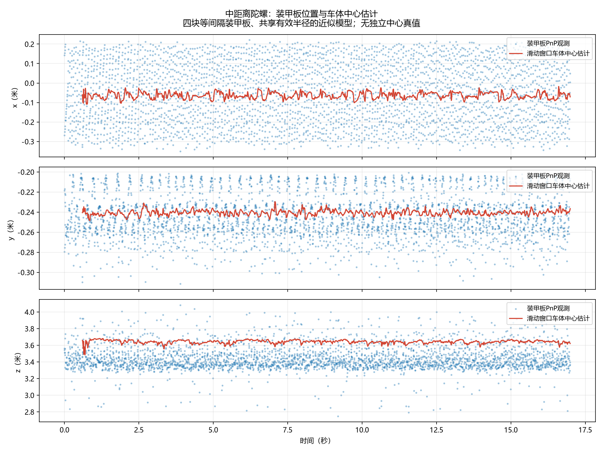
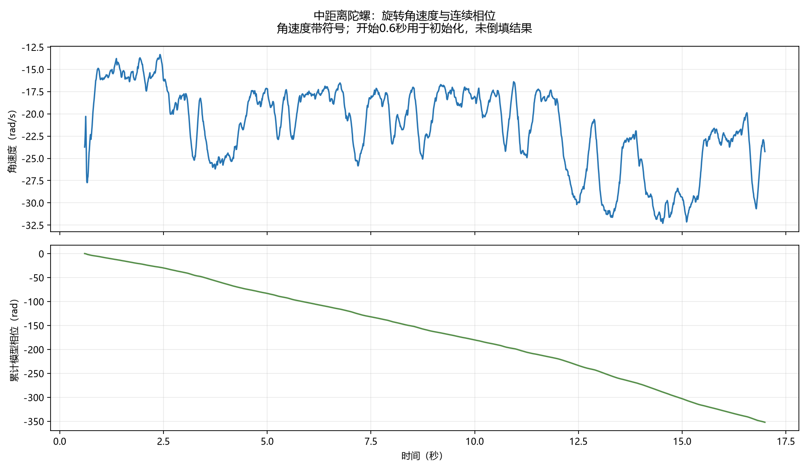
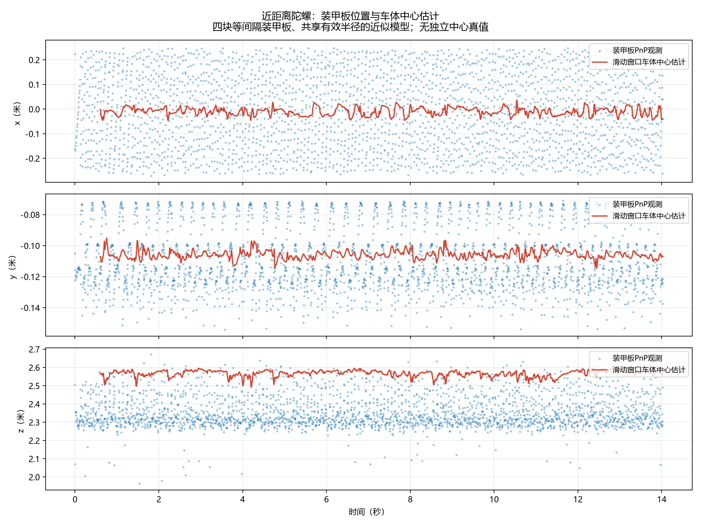
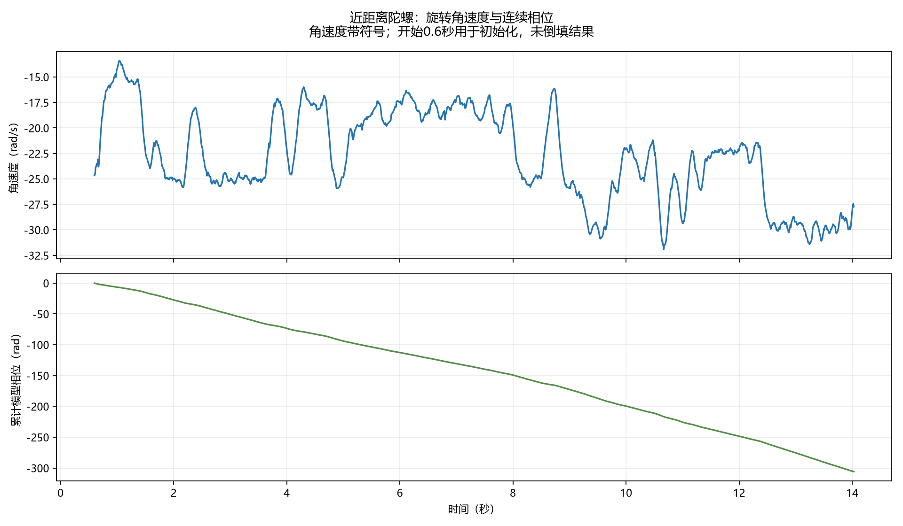

# 中、近距离陀螺：车体中心与旋转角速度估计

记录日期：2026-10-18。已生成两段的初版CSV和曲线，使用原始PnP有效位姿，不替换此前的检测数据。

## 1. 模型假设与中心定义

采用四块等角间隔装甲板、共享有效半径、近似水平旋转的简化模型。四板等角是建模假设，需要与实际测试台结构核对；不能将该假设当作由程序识别得到的事实。真实板间距、半径、高度或转轴倾斜不符合模型时会产生偏差。

中心cx、cz表示装甲板环绕的水平旋转中心，cy定义为平均装甲板中心平面的高度参考点，不是车辆质量中心，也不是已知机械轴上某个指定高度的精确位置。仅凭现有数据不能证明机械中心的绝对精度。

模型为：

```text
θᵢ(t) = θ(t) + kᵢ·π/2
xᵢ(t) = cx(t) - r·sin(θᵢ(t))
yᵢ(t) ≈ cy(t)
zᵢ(t) = cz(t) - r·cos(θᵢ(t))
```

yaw沿用原PnP模型+Z法线定义。这里的omega是该模型角度的变化率，单位rad/s；负号表示相对选定正方向反向旋转，不能在未定义观察视角时直接写成顺时针或逆时针。

## 2. 如何处理换板

原始yaw在换到相邻板时可能突然变化约π/2，不能把相邻CSV行直接相减当角速度。

把每块板的yaw映射为exp(j·4·yaw)，使四个等角板的相位落到同一个周期。多板同时可见时，按各自重投影残差加权求复数平均；相位一致性过低时不更新角度。

前0.6秒仅用于初始化：在当前已经到达的观测窗口内，进行圆周回归估计初始角速度和相位。初始化之前的90帧输出留空，不利用后续结果倒填。

初始化后使用状态[θ,omega]的角运动滤波器。创新按照π/2周期折回到预测附近，避免把换板当成整圈跳变。角加速度噪声允许速度随时间改变，未把omega固定为常数。

## 3. 如何估计中心

使用截至当前时刻的0.6秒滑动窗口，依据角相位与候选板对应的等角分支，拟合[cx,cy,cz,r]。用x/y/z不同权重处理深度较噪的现状，再采用鲁棒权重减弱不一致观测的影响。

没有将整段数据拟合出的一个中心复制到每一帧，也没有将“中心不动”直接写死。窗口内采用近似同一中心和同一角速度，因而这是带短时平稳假设的估计，面对快速中心平移或角加速度仍可能滞后。

原始散点全部保留在对比图中。估计中使用的是此前PnP已通过的位姿；86个中距离及141个近距离失败位姿没有被补造成观测。超过0.2秒缺少可用角度观测时停止输出。

## 4. 当前录像上的结果

| 指标 | 中距离陀螺 | 近距离陀螺 |
|---|---:|---:|
| 总帧数 | 2550 | 2105 |
| 有效中心/角速度帧数 | 2460 | 2015 |
| 首次输出时间 | 0.6s | 0.6s |
| 中心中位数(cx,cy,cz)/m | (-0.0644,-0.2407,3.6442) | (-0.0090,-0.1062,2.5712) |
| 中心时间标准差(x,y,z)/m | (0.0160,0.0024,0.0196) | (0.0158,0.0026,0.0172) |
| omega中位数/rad/s | -20.62 | -22.76 |
| omega的5%～95%分位/rad/s | -30.50～-15.49 | -29.99～-16.33 |
| 角速度绝对值中位数/转每秒 | 3.28 | 3.62 |
| 有效半径中位数/m | 0.2682 | 0.2695 |
| 窗口位置模型拟合RMS中位数/m | 0.0843 | 0.0590 |

这些是模型估计，不是机械中心和编码器转速真值。中心时间标准差仅表示录像中输出的稳定程度，不是测距精度；窗口拟合RMS也不是绝对位置误差。角速度曲线有明显变化，可能同时包含真实速度变化和PnP/相位估计噪声，尚无独立转速测量区分它们。

## 5. 必需图表

### 中距离





### 近距离





另有center_topview_<视频名>.png俯视图，以及spin_diagnostics_<视频名>.png模型半径、拟合残差和同帧相位一致性诊断图。

## 6. 输出格式与复现

pred_中距离陀螺.csv、pred_近距离陀螺.csv均采用题目要求的表头：

```text
t,cx,cy,cz,omega
```

t=n/150，位置单位m、角速度rad/s。前90帧初始化行的四个估计字段留空。输出覆盖整段帧号，而非删去初始化时间轴。

运行：

```powershell
python qA_aim/estimate_spin.py --video all
```

--video可选中距离陀螺、近距离陀螺或all。脚本从对应检测CSV、quality CSV和帧数元数据读取输入。参数在estimate_spin.py的CONFIG中，未修改平移滤波参数。

spin_estimation_summary.json保存运行统计；spin_state_diagnostics_<视频名>.csv保存逐帧诊断；spin_phase_<视频名>.csv保存连续模型相位。

## 7. 做过哪些验证

- 已知中心、半径、恒定角速度的理想合成旋转：恢复给定中心与转速。
- 加入位置/角度噪声及缓慢角加速度的合成数据：中心误差中位数约0.0032m，角速度误差中位数约0.047rad/s。合成数据满足本模型，不能将其精度外推到真实录像。
- 人为长时缺测：0.2秒后输出留空，恢复有效观测后重新产出结果。
- 人为移动中心：输出随中心改变，验证没有写死固定中心。
- 截断真实输入到前700帧再计算，此前结果与完整输入一致，验证未利用未来样本。
- 检查两段CSV的列名、行数、150fps时间戳及初始化空行。

完整检查记录：spin_estimation_validation.json。当前仍需现场核对装甲板几何、独立转速或逐圈视频标注，以及更准确的原始位姿，才能进一步验证实际精度。
