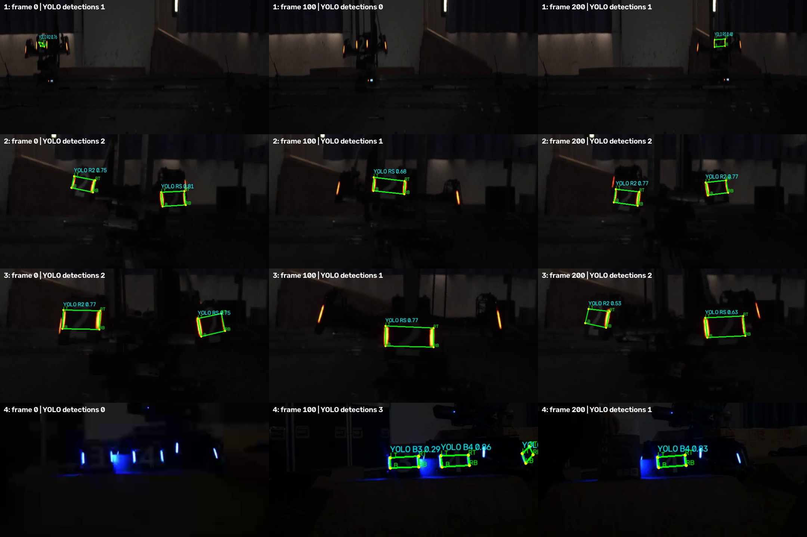
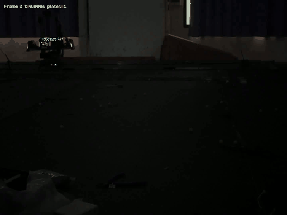
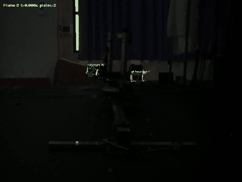
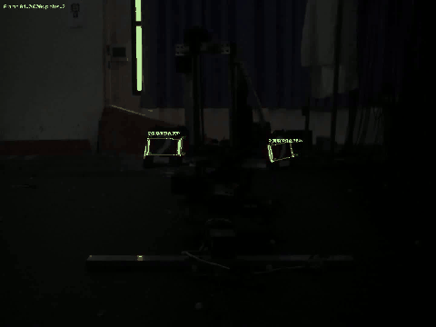
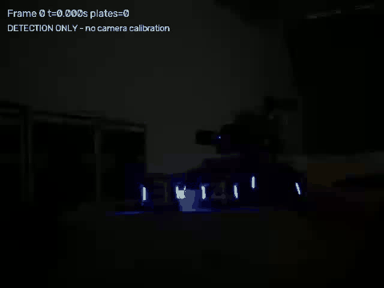

# YOLO ONNX 装甲板四关键点扩展

此目录将传统颜色阈值检测替换为已提供的YOLO四关键点模型，其余PnP与估计按相同坐标约定运行。作为扩展实验提交，不替换qA_aim传统主结果，不等同于完成附加题一网络训练与速度对照。

## 模型与推理

模型：models/exp-2.onnx，元数据为YOLO26n-pose；输入1×3×640×640、输出1×26×8400。26=4框参数+14类得分+8关键点坐标，无独立objectness通道、无单点置信度。类别为B1～B5、BO、BS、R1～R5、RO、RS。

OpenCV DNN加载ONNX；默认CPU后端。无需PyTorch、Ultralytics或ONNX Runtime。预处理为保持比例缩放、114灰边、BGR转RGB、除255；筛最高分类分数并按R/B前缀选颜色；NMS跨类别去重；四点减补边、除缩放回原图，再按LT/LB/RB/RT排序。绿色四边形来自模型关键点，不是检测框四角。

## 代码入口

| 文件 | 职责 |
|---|---|
| yolo_detector.py | 中文分段注释；元数据、输入预处理、推理、解码、NMS、四点与画图 |
| preview_yolo.py | 识别窗口、置信度/IoU滑动条、PnP显示、参数截图保存 |
| armor_step1.py、blue_detector.py | 兼容原分析接口的YOLO调用 |
| run_analysis.py | 远、中距离逐帧检测/PnP与平移预测 |
| run_extra.py | 近距离PnP与蓝色只检测 |
| estimate_spin.py | 中、近距离中心与角速度 |
| launch.py | 中文运行菜单 |
| yolo_config.json | 当前confidence=0.25、iou=0.45 |

## 运行

```bash
python qA_yolo/preview_yolo.py --video 中距离陀螺
python qA_yolo/run_analysis.py --video all
python qA_yolo/run_extra.py --video all
python qA_yolo/estimate_spin.py --video all
```

预览空格播放/暂停、S保存模型阈值和截图、Q退出。提高confidence通常减少低分结果，也可能增加漏检；降低NMS IoU使重叠框更容易被抑制，也可能压掉相邻真板。原颜色阈值不再生效。

## 完整视频结果

| 视频 | 总帧 | 有候选帧 | 候选行 | 有效PnP |
|---|---:|---:|---:|---:|
| 远距离 | 1546 | 1349 | 1352 | 1341 |
| 中距离 | 2550 | 2539 | 3454 | 3453 |
| 近距离 | 2105 | 2083 | 2779 | 2772 |
| 蓝色 | 1684 | 1672 | 3623 | 不解算 |

这是输出覆盖，不是准确率。四段视频、CSV、预测、中心曲线与诊断均已保存。远距离预测只有494组有效比较、三维差RMSE约0.568m；由于有效样本不同，不将其与传统版1482样本的0.271m直接作公平数值排名。



[远距离视频](figures/detected_远距离平移.mp4) · [中距离视频](figures/detected_中距离陀螺.mp4) · [近距离视频](figures/detected_近距离陀螺.mp4) · [蓝色视频](figures/detected_装甲板_蓝.mp4)

## 限制

远距离小目标存在漏检与角点偏差，分类标签也未人工核验。训练点名称只有0/1/2/3，物理语义需与标注核对；按x分左右的排序不适用于大角度翻滚。PnP沿用题目135×55mm几何，不根据类别猜测其他尺寸；更换目标尺寸会导致距离偏差。

当前未进行实车相机标定、坐标外参转换、控制或GPU加速验证。保留PT权重只是归档，未在本项目中训练或验证与ONNX的数值等价。

模型来源与许可见[来源说明](../docs/data_and_model_sources.md)，本次检查见[yolo_validation.json](yolo_validation.json)。

## 网页快速预览

以下GIF仅展示前6秒、降采样至约10fps，便于网页浏览；完整帧率与完整时长以MP4和CSV为准。

### 远距离平移



### 中距离陀螺



### 近距离陀螺



### 装甲板_蓝



